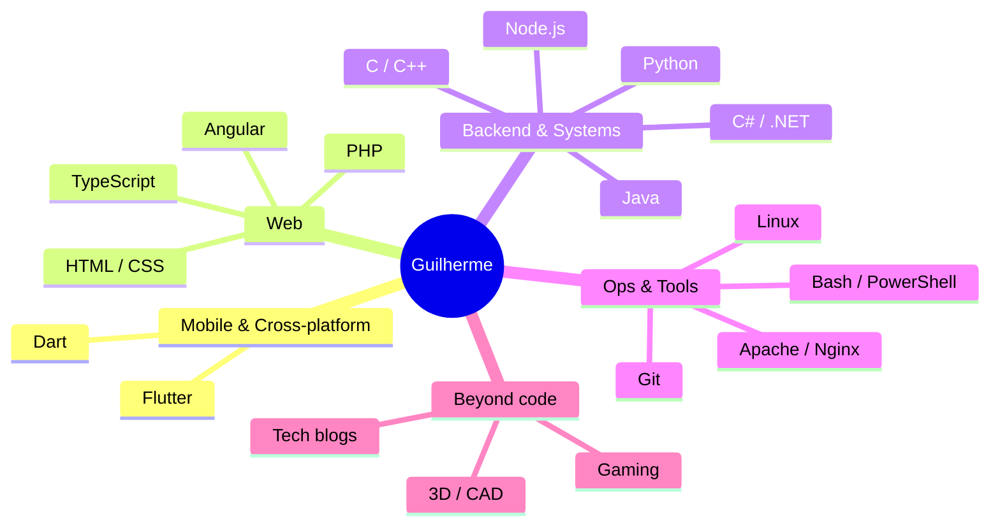
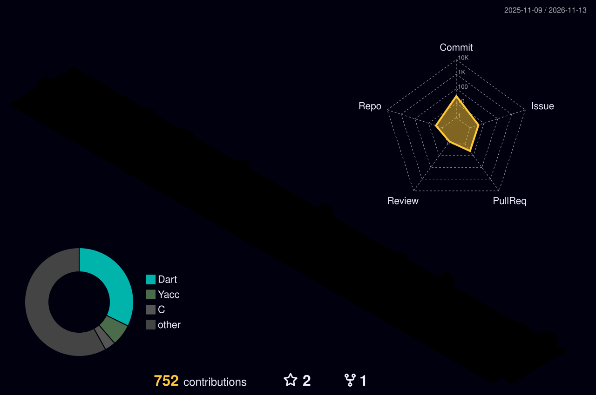

<!-- ═══════════════════════ HEADER ═══════════════════════ -->
<div align="center">


<a href="https://github.com/the-silveira">
  
</a>

<br/><br/>


<br/><br/>

<sub>🧭 <a href="#-about">About</a> · <a href="#%EF%B8%8F-tech-arsenal">Stack</a> · <a href="#-featured-projects">Projects</a> · <a href="#-github-analytics">Analytics</a> · <a href="#-lets-connect">Connect</a></sub>

</div>

<br/>

<!-- ═══════════════════════ ABOUT ═══════════════════════ -->

## 💻 `~/guilherme $ cat about.md` <a name="-about"></a>

<div align="center">
<table>
<tr>
<td width="55%" valign="top">

```js
const guilherme = {
  username:  "the-silveira",
  role:      "Software Developer",
  mission:   "Build useful things, ship them,
              learn, repeat.",
  focus:     ["Cross-platform apps",
              "Clean code",
              "Open source"],
  stack:     ["Flutter", "Dart", "Angular",
              "C#/.NET", "Python"],
  offline:   ["Gaming 🎮", "Tech blogs 📚",
              "3D modelling in CAD 🧊"],
  lookingFor: "Good ideas, good people,
               good PRs",
  motto:     "Ship it. Learn from it.
              Make it better.",
};
```

</td>
<td width="45%" valign="top" align="center">


</td>
</tr>
</table>
</div>

<br/>

## 🎯 What I'm Up To

<table align="center">
  <tr>
    <td align="center" width="25%">🔭<br/><b>Exploring</b><br/><sub>New frameworks & tools</sub></td>
    <td align="center" width="25%">🌱<br/><b>Improving</b><br/><sub>Flutter apps & architecture</sub></td>
    <td align="center" width="25%">🤝<br/><b>Open to</b><br/><sub>Open-source collabs</sub></td>
    <td align="center" width="25%">⚡<br/><b>Ask me about</b><br/><sub>Flutter, Dart, .NET, Linux</sub></td>
  </tr>
</table>

<br/>

## 🧠 My Dev Universe



<br/>

<!-- ═══════════════════════ STACK ═══════════════════════ -->

## 🛠️ Tech Arsenal

<div align="center">

**⌨️ Languages**<br/>


**🧩 Frameworks**<br/>


**🧰 Tools & Platforms**<br/>


</div>

<details>
<summary><b>🔎 See the full list</b></summary>
<br/>

| Category | Tech |
|---|---|
| **Languages** | HTML · CSS · JavaScript · TypeScript · PHP · C · C++ · C# · Dart · Java · Python · Bash · PowerShell · Visual Basic · x86/ARM Assembly · XML · JSON · MySQL |
| **Frameworks** | Flutter · Angular · .NET Core · .NET |
| **Software** | Linux · Windows · VS Code |
| **Tools** | Git · npm · Jupyter · Node.js · Apache · Nginx |

</details>

<br/>

<!-- ═══════════════════════ PROJECTS ═══════════════════════ -->

## 🚀 Featured Projects

<div align="center">
<table>
  <tr>
    <td width="33%" valign="top" align="center">
      <h3>🧶 StitchCounter</h3>
      <sub>A simple, elegant crochet helper app for tracking stitches and rounds.</sub><br/><br/>
      <a href="https://github.com/the-silveira/StitchCounter">
        
      </a>
    </td>
    <td width="33%" valign="top" align="center">
      <h3>📦 RoomInventory</h3>
      <sub>Cross-platform Flutter application for managing room inventories.</sub><br/><br/>
      <a href="https://github.com/the-silveira/RoomInventory">
        
      </a>
    </td>
    <td width="33%" valign="top" align="center">
      <h3>🏋️ WeiNote</h3>
      <sub>Gym personal performance database to track your progress.</sub><br/><br/>
      <a href="https://github.com/the-silveira/WeiNote">
        
      </a>
    </td>
  </tr>
</table>
</div>

<br/>

<!-- ═══════════════════════ STATS ═══════════════════════ -->

## 📊 GitHub Analytics <a name="-github-analytics"></a>

<div align="center">


</div>

### 📈 Contribution Graph

<div align="center">
  
</div>

<br/>

<!-- ═══════════════════════ 3D ═══════════════════════ -->

## 🏙️ My Contributions in 3D

<div align="center">
  
</div>

<br/>

<!-- ═══════════════════════ SNAKE ═══════════════════════ -->

## 🐍 The Snake Eats My Contributions

<div align="center">
  <picture>
    <source media="(prefers-color-scheme: dark)" srcset="https://raw.githubusercontent.com/the-silveira/the-silveira/output/github-snake-dark.svg" />
    <source media="(prefers-color-scheme: light)" srcset="https://raw.githubusercontent.com/the-silveira/the-silveira/output/github-snake.svg" />
    
  </picture>
</div>

<br/>

<!-- ═══════════════════════ BEYOND ═══════════════════════ -->

## 🎮 Beyond the Code

<div align="center">
<table>
  <tr>
    <td align="center" width="25%">🎮<br/><b>Gaming</b><br/><sub>Where bugs are features</sub></td>
    <td align="center" width="25%">📚<br/><b>Tech blogs</b><br/><sub>Daily dose of new ideas</sub></td>
    <td align="center" width="25%">🧊<br/><b>CAD modelling</b><br/><sub>3D designs from scratch</sub></td>
    <td align="center" width="25%">🧶<br/><b>Crafty tools</b><br/><sub>Apps for the things I love</sub></td>
  </tr>
</table>
</div>

<details>
<summary><b>🥚 Dev humour (click at your own risk)</b></summary>
<br/>

```text
Q: Why do programmers prefer dark mode?
A: Because light attracts bugs. 🐛

Q: How many programmers does it take to change a light bulb?
A: None. That's a hardware problem.

$ git commit -m "fix"
$ git commit -m "fix again"
$ git commit -m "final fix"
$ git commit -m "final fix (really)"
```

</details>

<br/>

<!-- ═══════════════════════ QUOTE ═══════════════════════ -->

<div align="center">
  
</div>

<br/>

<!-- ═══════════════════════ CONNECT ═══════════════════════ -->

## 🤝 Let's Connect <a name="-lets-connect"></a>

<div align="center">

<a href="https://github.com/the-silveira">
  
</a>

<sub>Open to collaborating on open-source projects, new ideas and good conversations about tech.</sub>

<br/><br/>

⭐ **Liked something you saw? Drop a star!** ⭐

<a href="https://github.com/the-silveira">
  
</a>


</div>
